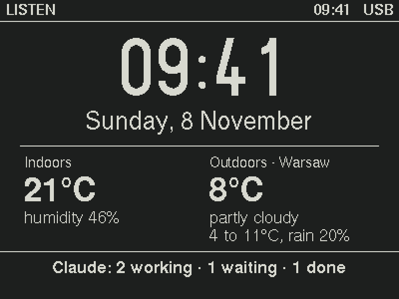
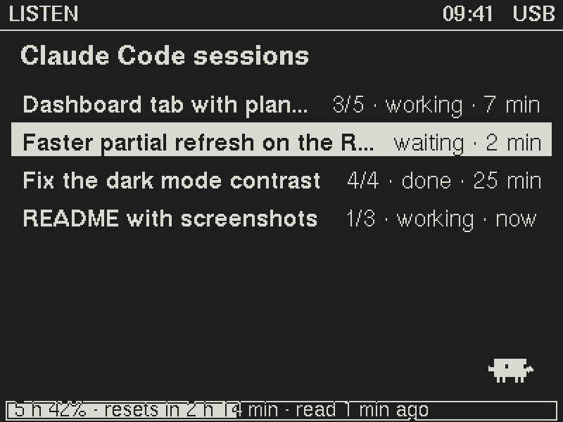
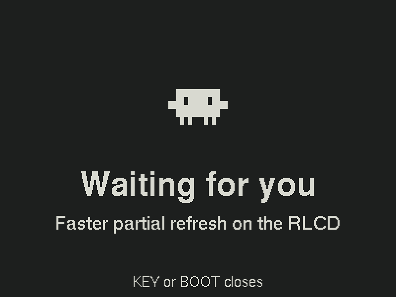
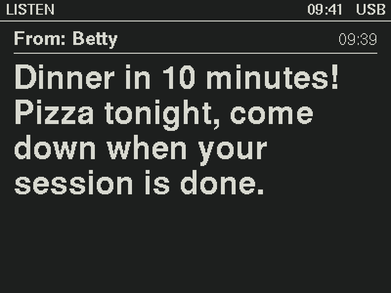
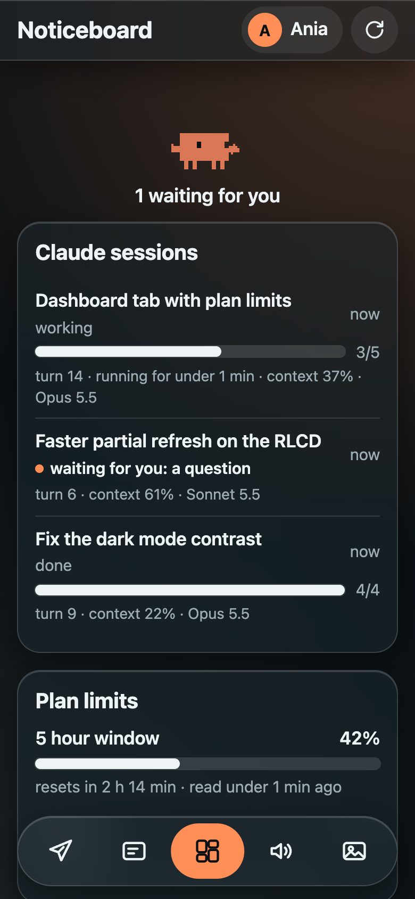
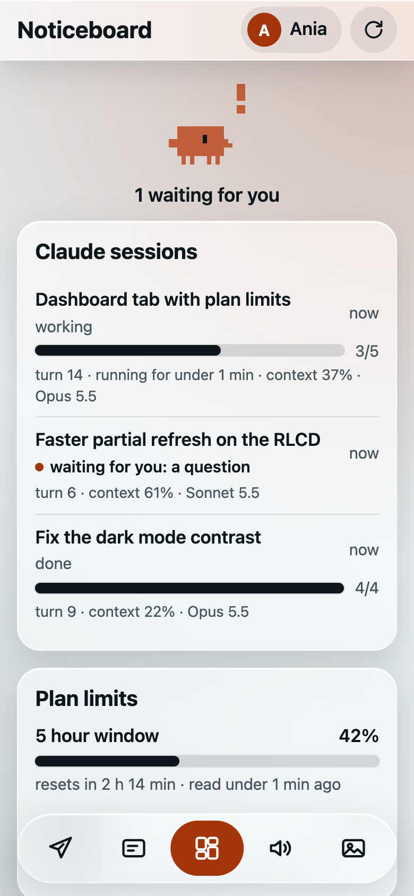
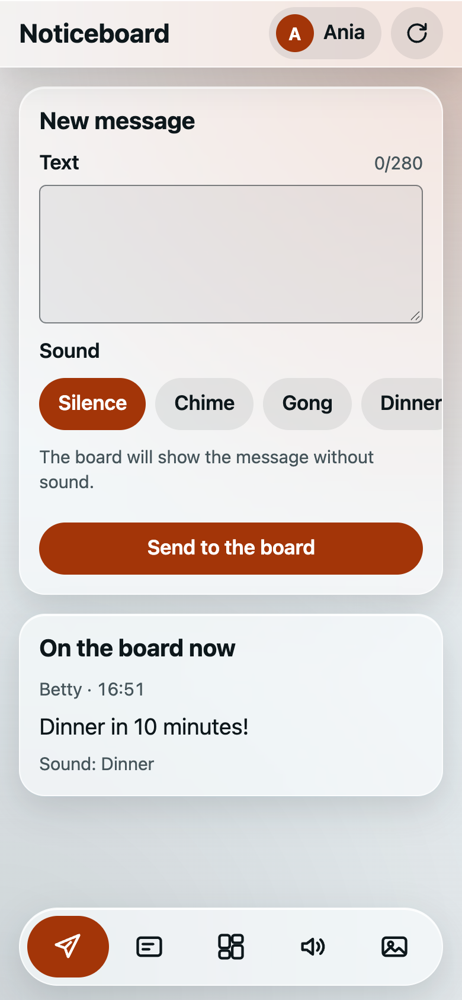
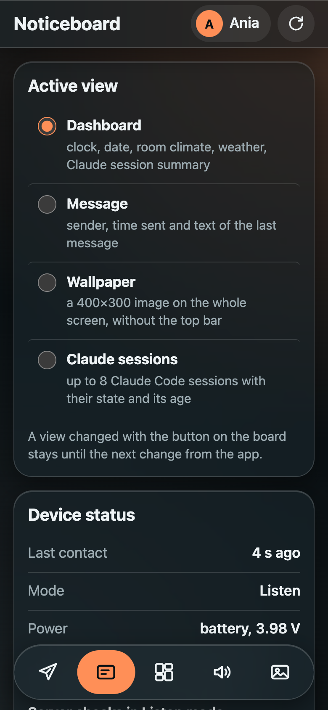
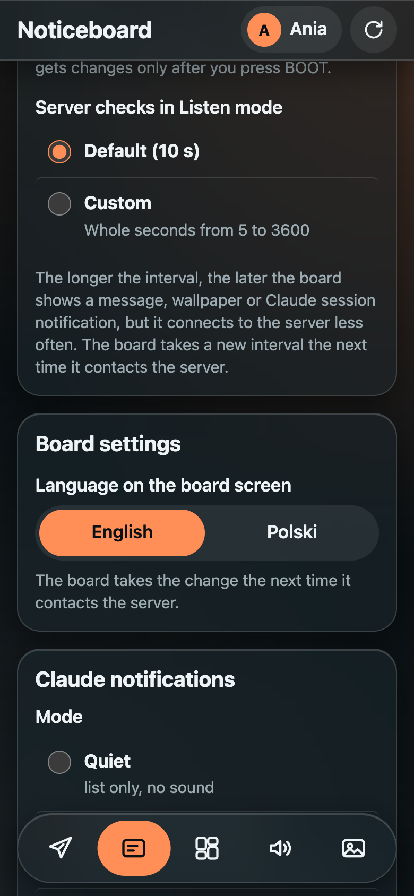
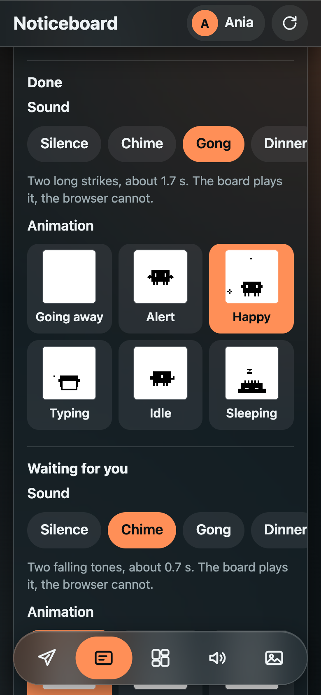

<div align="center">



# Claude Code ESP32-S3-RLCD-4.2 Dashboard

**A paper-like desk noticeboard that shows your Claude Code sessions, plan limits, the time, the weather and messages from the people you live with.**

Firmware for the Waveshare ESP32-S3-RLCD-4.2, a plain PHP server and a phone app, Noticeboard (*Tablica* in Polish).


</div>

## See it in action

<p align="center">
  <a href="https://youtu.be/NNZ-SbqHNbI" title="Watch the board in action on YouTube">
    
  </a>
  <br>
  <sub>▶ <a href="https://youtu.be/NNZ-SbqHNbI">Watch on YouTube</a>: the board on a desk, live with Claude Code sessions</sub>
</p>

## On the board

The screen is a reflective LCD: it is lit by the room, like paper, with no backlight. 400×300 pixels, one bit per pixel. The images below are rendered pixel for pixel from the firmware's own `views.c` on a desktop build.

<table>
  <tr>
    <td width="50%"></td>
    <td width="50%"></td>
  </tr>
  <tr>
    <td><b>Sessions.</b> Every Claude Code session gets a row with its title, task progress, state and how long it has been in it. A session waiting for you is inverted.</td>
    <td><b>Notifications.</b> When a session finishes or asks you something, the board shows it full screen with an animated Clawd and plays a sound.</td>
  </tr>
  <tr>
    <td></td>
    <td></td>
  </tr>
  <tr>
    <td><b>Messages.</b> Anyone at home can send a note from the app. It shows in the largest font that fits, with a sound of the sender's choice.</td>
    <td><b>Dashboard.</b> Clock and date, room temperature and humidity from the on-board sensor, the outdoor forecast and a session summary.</td>
  </tr>
</table>

A fourth view shows a full-screen wallpaper; you can see it in the [video above](#see-it-in-action).

## In the app

The app is a PWA served by the same PHP server. It runs on any phone, installs to the home screen and speaks English and Polish.

<p align="center">
  
  
  
</p>

<p align="center">
  
  
  
</p>

## Highlights

- **Claude Code sessions at a glance.** A hook reports each session's title, state (working, waiting, done), the reason it waits and its task-list progress.
- **Plan limits.** The status line script reports the five-hour and weekly limits, the model and context use per session.
- **Messages with sounds.** Choose a built-in sound or upload your own; the board plays it through its speaker.
- **Wallpapers.** Any photo becomes a dithered 400×300 one-bit image, in the app or with `tools/img2rlcd.py`.
- **Clock, weather and room climate.** Time from the RTC, the forecast from Open-Meteo, temperature and humidity from the SHTC3 sensor.
- **Three modes.** *Listen* keeps Wi-Fi on and asks the server every 5 s to 1 h. *On demand* syncs on a button press. *Offline* turns Wi-Fi off and keeps the clock and sensor running.
- **No database.** The server is a few PHP files that keep state in JSON files, so any shared PHP host works.
- **Outbound only.** The board never talks to your computer or the local network. It needs DNS and HTTPS, so it works on an isolated IoT Wi-Fi.
- **Separate tokens per role.** The board, the hook and every person have their own token. An optional device lock limits the app to a set number of phones.

## How it works

```
Claude Code hook ──HTTPS──┐
Noticeboard PWA  ──HTTPS──┼──▶ api.php ──HTTPS──▶ Open-Meteo
ESP32-S3 board   ──poll───┘    state in JSON files
(IoT Wi-Fi)
```

The board polls the server and draws what it gets back. A poll carries a revision number, so an unchanged state costs one short reply. Sessions, messages, the wallpaper and settings all live on the server; the board keeps the last state in flash and survives a restart.

## Hardware

[Waveshare ESP32-S3-RLCD-4.2](https://docs.waveshare.com/ESP32-S3-RLCD-4.2)

| Part | Detail |
|---|---|
| MCU | ESP32-S3-WROOM-1-N16R8: 16 MB flash, 8 MB PSRAM, Wi-Fi 2.4 GHz and Bluetooth LE |
| Display | 4.2″ reflective LCD, 400×300, one bit per pixel, ST7305 over SPI, no backlight |
| Sensors | SHTC3 temperature and humidity, PCF85063 real-time clock |
| Audio | ES8311 codec and a speaker |
| Other | microSD slot, 18650 battery holder, KEY, BOOT and PWR buttons |

**Buttons.** KEY switches the mode; held for 2 s it opens a status screen. BOOT syncs now; held for 2 s it moves to the next view.

## Repository

| Path | What it is |
|---|---|
| [`firmware/`](firmware) | board firmware in C on ESP-IDF 5.5, with u8g2 and its own ST7305 driver |
| [`server/`](server) | `api.php` and the PWA, for any PHP 8.1+ host |
| [`hook/`](hook) | Claude Code hook and status line script |
| [`tools/`](tools) | wallpaper converter and the Clawd animation pipeline |
| [`assets/clawd/`](assets/clawd) | Clawd animations used on the board |
| [`docs/SPEC.md`](docs/SPEC.md) | specification: modes, views, API and file formats (Polish) |
| [`docs/INSTRUKCJA.md`](docs/INSTRUKCJA.md) | step-by-step setup guide (Polish) |

## Quick start

1. **Server.** Copy `server/config.example.php` to `config.php` and fill in the tokens, the people and the location. Upload `server/` without `tests/` to a PHP 8.1+ host.
2. **Board.** Copy `firmware/main/secrets.h.example` to `secrets.h` and fill it in (Wi-Fi, server URL, device token), then build and flash with ESP-IDF 5.5: `idf.py build flash`.
3. **Claude Code.** Put the server URL and the hook token in `~/.config/rlcd/env`, then add the hook and status line from `hook/settings-snippet.json` to `~/.claude/settings.json`.
4. **App.** Open the server folder on a phone, sign in with a person's token and add the app to the home screen.

The full guide, with hosting checks, the device lock and terminal control over `curl`, is in [docs/INSTRUKCJA.md](docs/INSTRUKCJA.md).

## Tests

```bash
php server/tests/api_test.php
php server/tests/lock_test.php
php hook/tests/hook_test.php
node server/tests/app_test.mjs
python3 -I tools/tests/img2rlcd_test.py
```

The firmware's notification and wallpaper logic has host C tests in `firmware/tests/`.

## Credits

- Clawd animations: [marciogranzotto/clawd-tank](https://github.com/marciogranzotto/clawd-tank), MIT.
- [u8g2](https://github.com/olikraus/u8g2) by olikraus, BSD-2-Clause.
- Weather by [Open-Meteo](https://open-meteo.com/).
- Hardware by [Waveshare](https://www.waveshare.com/).

## License

[MIT](LICENSE) © 2026 Bartosz Iwańczyk
